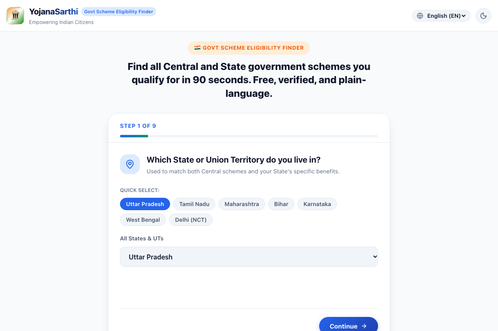
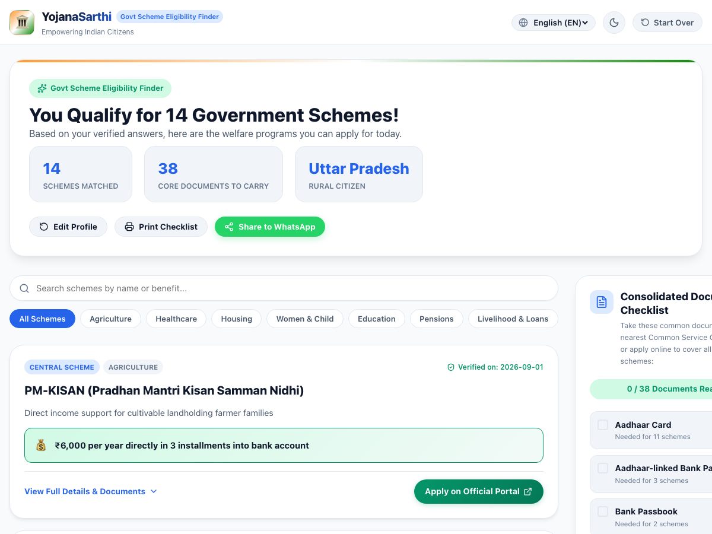
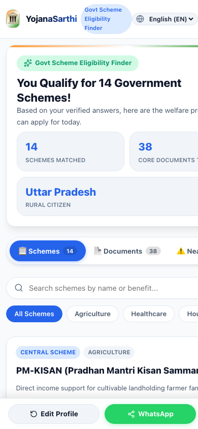

# 🏛️ YojanaSarthi (योजना सारथी)
### Instant Government Scheme Eligibility Finder for Indian Citizens

> **Zero-API • 100% Client-Side Privacy • Multi-Language (EN / HI / TA) • Automated Document Checklist**

Discover all Central and State government welfare schemes you qualify for in under 90 seconds. Built with a deterministic rules engine and powered by an automated Gemini Flash LLM ingestion pipeline.

---

## 📸 Screenshots

| 📋 Questionnaire Wizard | 🎯 Matched Schemes & Results |
|:---:|:---:|
|  |  |

<p align="center">
  <b>📱 Mobile Responsive View (with Segment Navigation & Floating Actions)</b><br/>
  
</p>

---

## ⚡ Key Features

- **⚡ Zero-API Client-Side Matching:** 
  Zero server latency and 100% offline-capable. Citizens' personal demographic and income data is never sent to external servers.
- **📄 Consolidated Document Checklist:** 
  Aggregates all paperwork needed across all matched schemes into a single printable/shareable checklist with checkboxes (e.g. *"To claim all 6 schemes, you only need these 4 common documents"*).
- **🌐 Trilingual Support:** 
  Instant 1-tap switching between **English**, **हिंदी (Hindi)**, and **தமிழ் (Tamil)** across all questions, benefits, and required documents.
- **⚠️ "Almost Qualified" (Near-Misses):** 
  Explains transparently why a user was rejected for a scheme by just 1 requirement (e.g., *“Income exceeds limit by ₹20,000”* or *“Age ceiling is 40”*).
- **📱 Mobile-First Architecture:** 
  Designed with sticky thumb-reach action bars, mobile segment tabs, 48px tap targets, and safe-area support.
- **🤖 Free Automated LLM Ingestion Pipeline:** 
  Convert messy government circulars, press releases, or PDFs into structured eligibility rules using Google Gemini Flash.
- **🖨️ Print & WhatsApp Share:** 
  Instant browser print formatting (`@media print` clean A4 sheet) and 1-click formatted WhatsApp messaging.

---

## 🛠️ Tech Stack

- **Frontend:** React 19, TypeScript, Vite
- **Styling:** Custom Vanilla CSS Design System (Light/Dark themes, Glassmorphism, Print CSS)
- **Icons & Micro-Interactions:** Lucide Icons, Canvas Confetti
- **Rule Engine:** Deterministic TypeScript rule evaluator
- **AI Ingestion:** Google Gemini Flash API (`gemini-flash-latest` cascade)

---

## 🚀 Quick Start

### 1. Clone & Install
```bash
git clone https://github.com/Ajmal0197/Scheme-Eligibility-Finder.git
cd Scheme-Eligibility-Finder
npm install
```

### 2. Start Development Server
```bash
npm run dev
```
Open **[http://localhost:5173](http://localhost:5173)** in your browser.

### 3. Production Build
```bash
npm run build
npm run preview
```

---

## 🤖 Automated Scheme Ingestion Pipeline

To parse and add new government schemes from unstructured text using Google Gemini:

### Setup API Key
Create a `.env` file in the root directory:
```bash
GEMINI_API_KEY=your_gemini_api_key_here
```
*(Get a free key in 30 seconds at [aistudio.google.com](https://aistudio.google.com/)).*

### Ingestion Commands
```bash
# 1. Preview structured output in /staging:
npm run ingest -- --file scripts/sample-schemes/pm-surya-ghar.txt

# 2. Preview and automatically merge into live database:
npm run ingest -- --file scripts/sample-schemes/pm-surya-ghar.txt --merge

# 3. Ingest directly via text string:
npm run ingest -- --text "Scheme name, Ministry, benefits, criteria..." --merge
```

---

## 🌐 Free Deployment

### Deploy to GitHub Pages (Automated CI/CD)
1. Go to your repository on GitHub: **Settings > Pages**.
2. Under **Build and deployment > Source**, select **"GitHub Actions"**.
3. Every push to `main` will build and publish the site automatically to:
   `https://<your-username>.github.io/Scheme-Eligibility-Finder/`

### Deploy to Vercel
1. Import repository at [vercel.com/new](https://vercel.com/new).
2. Click **Deploy**. Vercel automatically detects the Vite configuration and outputs a live URL.

---

## ⚖️ License & Disclaimer

- **Disclaimer:** YojanaSarthi is an independent citizen-assist utility and is not affiliated with any government ministry. Final eligibility is determined by official authorities upon document verification.
- **License:** MIT License. Free to use, adapt, and build upon.
